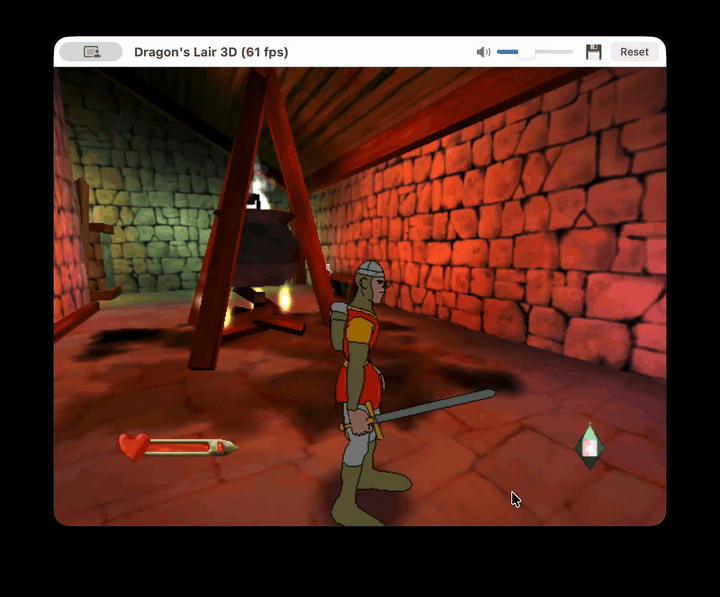

<p align="center">
  
</p>

# anybox

Turns an original Xbox disc image into a macOS app, packed in a disk image, from the command line
or from a window.

<p align="center">
  
</p>

```
anybox [--runtime DIR] [--work DIR] [--pack-level N] ISO ICON NAME DMG
```

| Argument | Meaning |
|---|---|
| `ISO` | the disc image (XDVDFS) |
| `ICON` | an image file, or an `http(s)` link, for the app's icon; empty (`""`) for the icon an earlier build left in the work directory, else the title image the executable carries (a plain icon when it has none) |
| `NAME` | the title's name, shown by macOS |
| `DMG` | the disk image to write |

`anybox-gui` does the same from a window: drop the disc or the icon on it, press Build, and each phase (lifting, compressing, compiling, linking, the disk image) fills a bar
with its percentage and the time left. It links with this workspace's release runtime
(`cargo build --release -p runtime`). The command line shows the same progress on one line.

It runs on macOS on Apple silicon and needs `clang`, `sips`, `iconutil`, `codesign` and `hdiutil`,
which come with Xcode's command line tools and the system.

With `--rust` the command line lifts the title to Rust instead of C and compiles it with `rustc`,
which rustup installs, then links it with `ld` against the macOS SDK. That path needs no `clang`.
It builds the same app, and compiles about three times slower: BLiNX takes 1 minute 41 seconds of
compiling against 35 seconds of C.

## What it does

1. Reads `default.xbe` from the disc and finds the title's functions.
2. Finds the statically linked library functions the runtime replaces, by byte signature.
3. Lifts the title's x86 code to C (the `lift` crate) and compiles it for arm64 with clang, or with
   `--rust` lifts it to Rust and compiles it with `rustc`.
4. Writes the disc's other files to a zstd-compressed pack that the app carries.
5. Links the lifted code with the runtime, builds the app with the icon and the pack, signs
   it for this machine (ad hoc), and writes the disk image.

## The runtime

The runtime is the `runtime` crate in this repository, written clean room. It implements the
console's kernel, graphics and audio, and the lifted code calls into it through the symbols declared
in `crates/anybox-core/src/glue.rs` (or `crates/anybox-core/lifted/glue.rs` for Rust)
(`anyxbox_native_call`, `anyxbox_thread_end`, `anyxbox_main_loop` and a few more). Its build leaves
two files side by side in `target/<profile>`, and the tool takes the directory holding them:

- `libruntime.a`, the static library;
- `signatures.txt`, the list of library functions the runtime replaces, one `name | argument bytes |
  byte pattern` per line (`xdk::parse` documents the format).

The signature list is data that belongs to the runtime: it and the library must agree, because both
number the replaced functions in the same order and the numbers become trap addresses. They always
do when they come from one build. The directory is `--runtime DIR`, else `$ANYBOX_RUNTIME`, else
`runtime` beside the program. The window and `scripts/make-app.sh` use the one this checkout builds.

`anybox --plan ISO` prints the functions it would hand to the runtime, and stops.

## Crates

| Crate | What it is |
|---|---|
| `xbe` | parser for Xbox executables |
| `xiso` | reader for XDVDFS disc images |
| `xdk` | byte-signature matcher for statically linked library functions |
| `lift` | lifts 32-bit x86 (with x87, SSE and MMX) to C, or to `no_std` Rust |
| `pack` | a read-only, zstd-compressed archive of a disc's files |
| `anybox-core` | the build, from the disc to the disk image, reporting its progress as events |
| `anybox-cli` | the command line tool, `anybox` |
| `anybox-gui` | the window, `anybox-gui`, built with gpui-component |

## Tests

`cargo test --workspace` needs no disc image and no emulator. The lifter's tests lift
hand-assembled functions to C and to Rust: when `clang` is installed they check that the C compiles,
and they compile the Rust with `rustc` and run it.

## Legal

This repository holds no game data and no console firmware. You need your own disc image of a game
you own. It is not affiliated with Microsoft.

## Licence

Licensed under either of the Apache License, Version 2.0 (`LICENSE-APACHE`) or the MIT licence
(`LICENSE-MIT`) at your option.
